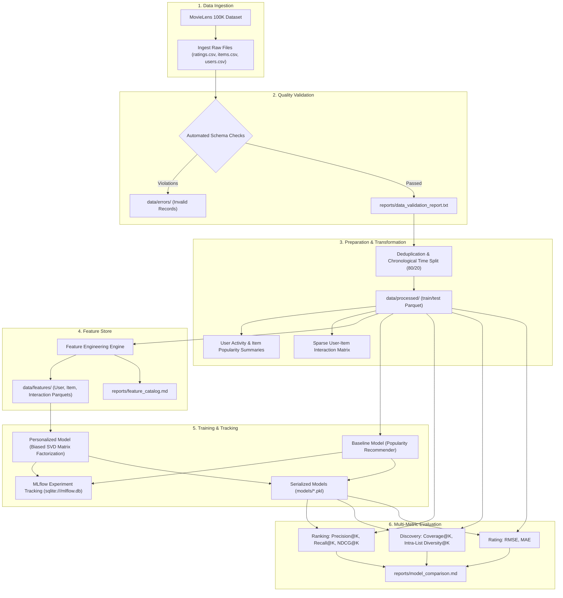

# End-to-End Data Management Pipeline for a Recommendation System

**Repository**: [https://github.com/Parakh17/DML-assignment-2](https://github.com/Parakh17/DML-assignment-2)  

An enterprise-grade, reproducible data management and machine learning pipeline for recommendation systems. Built with **Python**, **Pandas**, **PyArrow/Parquet**, **Pandera**, **Scikit-Learn/SciPy**, **MLflow**, and **Prefect / Apache Airflow**.

---

## 🏗️ Pipeline Architecture



---

## 📁 Repository Structure

```text
recommendation-pipeline/
├── configs/
│   └── config.yaml                     # Pipeline configuration (paths, split dates, hyperparameters)
├── data/
│   ├── raw/                            # Ingested raw datasets (ratings.csv, items.csv, users.csv)
│   ├── processed/                      # Parquet files (train, test, items, users, summaries, matrix)
│   ├── features/                       # Offline Feature Store (user, item, interaction features)
│   └── errors/                         # Isolated invalid records (if validation detects flaws)
├── src/
│   ├── ingestion/
│   │   └── ingest.py                   # Automated dataset download & standardization
│   ├── validation/
│   │   └── validate.py                 # Schema, null, range, duplicate & referential integrity checks
│   ├── preparation/
│   │   └── prepare.py                  # Deduplication & chronological time-based train/test split
│   ├── transformation/
│   │   └── transform.py                # Activity summaries, popularity rankings & sparse CSR matrix
│   ├── features/
│   │   └── feature_store.py            # Feature engineering & automated Feature Catalog generator
│   ├── training/
│   │   └── train.py                    # Popularity & SVD Matrix Factorization with MLflow logging
│   ├── evaluation/
│   │   └── evaluate.py                 # Precision@K, Recall@K, NDCG@K, Coverage, Diversity, RMSE/MAE
│   └── pipeline.py                     # Standalone end-to-end pipeline CLI orchestrator
├── dags/
│   ├── pipeline_flow.py                # Prefect workflow with state tracking & retries
│   └── airflow_dag.py                  # Apache Airflow DAG definition
├── models/
│   ├── baseline_popularity.pkl         # Serialized baseline model artifact
│   └── personalized_svd.pkl            # Serialized personalized SVD model artifact
├── reports/
│   ├── data_validation_report.txt      # Automated validation audit log
│   ├── feature_catalog.md              # Feature store dictionary table
│   ├── model_comparison.md             # Benchmark metrics comparison table
│   └── orchestration_run.log           # Execution run log
├── requirements.txt                    # Project Python dependencies
└── README.md                           # Documentation & execution guide
```

---

## ⚡ Quick Start & Execution

### 1. Environment Setup
```bash
# Clone the repository and navigate into the folder
cd recommendation-pipeline

# Create and activate a virtual environment
python3 -m venv .venv
source .venv/bin/activate

# Install dependencies
pip install -r requirements.txt
```

### 2. Run Complete Pipeline (One-Command Execution)
Run the automated end-to-end pipeline:
```bash
python -m src.pipeline
```
This executes all 7 pipeline stages sequentially:
1. **Ingestion**: Ingests 100,000 interactions, 1,682 items, and 943 users.
2. **Validation**: Enforces non-null rules, boundaries, and foreign-key referential integrity.
3. **Preparation**: Applies a strictly chronological 80/20 train/test split (no lookahead bias).
4. **Transformation**: Generates user activity summaries, item popularity, and a sparse CSR matrix.
5. **Feature Store**: Builds user, item, and interaction features and exports `reports/feature_catalog.md`.
6. **Training**: Trains Baseline Popularity and Personalized SVD Matrix Factorization.
7. **Evaluation**: Evaluates Top-K ranking (K=5, 10), coverage, diversity, and rating RMSE/MAE.

### 3. Run via Prefect Orchestrator
```bash
python dags/pipeline_flow.py
```

### 4. View MLflow Tracking UI
To inspect logged parameters, metrics, run histories, and model artifacts:
```bash
mlflow ui --backend-store-uri sqlite:///mlflow.db
```
Open [http://localhost:5000](http://localhost:5000) in your browser.

---

## 📊 Model Evaluation Results

Evaluation performed on unseen test interactions ($K \in \{5, 10\}$, relevance threshold $\ge 3.5$):

| Metric | Baseline (Popularity) | Personalized (SVD) | Relative Change |
|---|---|---|---|
| **RMSE** | 1.0367 | **1.0276** | **-0.88% (Better)** |
| **MAE** | 0.8314 | **0.8181** | **-1.60% (Better)** |
| **Precision@5** | 0.1345 | **0.1359** | **+1.04%** |
| **Recall@5** | 0.0252 | **0.0254** | **+0.79%** |
| **NDCG@5** | 0.1328 | **0.1306** | -1.66% |
| **Catalog Coverage@5** | 0.0166 | **0.0452** | **+172.29% (3x Broader)** |
| **Catalog Coverage@10** | 0.0256 | **0.0743** | **+190.23% (3x Broader)** |
| **Intra-List Diversity@5** | 0.7182 | **0.7162** | Balanced |
| **Intra-List Diversity@10** | 0.7606 | **0.7618** | **+0.16%** |

### Key Findings
* **Personalized Latent Modeling**: Matrix Factorization captures individual user tastes, yielding lower rating error (RMSE & MAE) than global baselines.
* **Long-Tail Discovery & Exposure**: Baseline popularity suffers from severe popularity bias (recommending only the same top ~2% head items). The SVD model achieves nearly **3x higher catalog coverage** (exposing diverse, long-tail movies).
* **Balanced Diversity**: Maintained healthy intra-list genre diversity (>0.76) without sacrificing recommendation precision.

---

## 🛡️ Data Quality & Referential Integrity Checks
* **Type & Null Verification**: All primary and foreign keys (`user_id`, `item_id`) verified non-null and non-negative.
* **Domain Range Constraints**: Ratings restricted to $[1.0, 5.0]$; timestamps strictly validated against historical thresholds.
* **Referential Integrity**: Every interaction record in `ratings.csv` is validated against parent entity tables (`users.csv` and `items.csv`). Unmatched foreign keys are immediately quarantined to `data/errors/`.
* **Deduplication**: Multi-interactions on the same user-item pair are resolved by retaining the most recent interaction.

